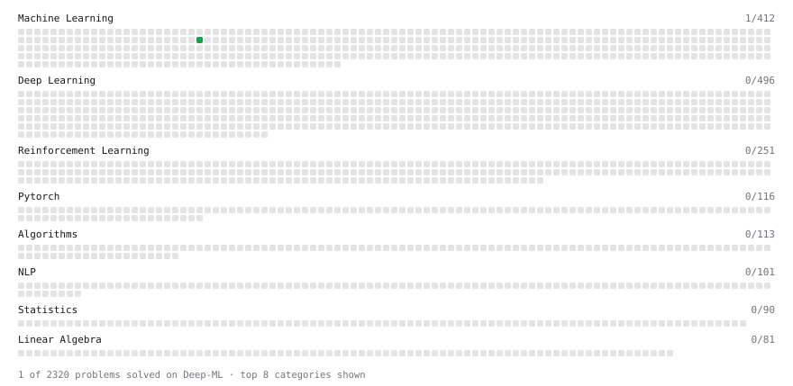

# Deep-ML

My machine learning practice from [Deep-ML](https://www.deep-ml.com). Every solution here was written by hand.

**25** solved · 18 problems · 0 labs · 7 math

[**Browse the interactive portfolio**](https://hdnguyen1802.github.io/deep-ml/) to replay this filling in over time.

## Problems

| | Difficulty | Solved | |
| --- | --- | --- | --- |
| [Calculate P50/P95/P99 Latency Percentiles](https://www.deep-ml.com/problems/293) | easy | 2026-11-17 | [solution](problems/0293-calculate-p50-p95-p99-latency-percentiles) |
| [Compute Arithmetic Intensity and Classify Bottleneck](https://www.deep-ml.com/problems/414) | easy | 2026-11-17 | [solution](problems/0414-compute-arithmetic-intensity-and-classify-bottleneck) |
| [Compute TTFT ITL and TPS from a Token Timestamp Stream](https://www.deep-ml.com/problems/411) | easy | 2026-11-16 | [solution](problems/0411-compute-ttft-itl-and-tps-from-a-token-timestamp-stream) |
| [Estimate Minimum GPU Count for Model Deployment](https://www.deep-ml.com/problems/412) | easy | 2026-11-19 | [solution](problems/0412-estimate-minimum-gpu-count-for-model-deployment) |
| [GPU Ops:Byte Ratio Calculation from Spec Sheet](https://www.deep-ml.com/problems/421) | easy | 2026-11-18 | [solution](problems/0421-gpu-ops-byte-ratio-calculation-from-spec-sheet) |
| [KV Cache Size Estimator for MLA vs MHA vs GQA](https://www.deep-ml.com/problems/1012) | easy | 2026-11-19 | [solution](problems/1012-kv-cache-size-estimator-for-mla-vs-mha-vs-gqa) |
| [Micro-batch Inference Throughput Estimation](https://www.deep-ml.com/problems/781) | easy | 2026-11-19 | [solution](problems/0781-micro-batch-inference-throughput-estimation) |
| [Normalized Latency and the Highest Request Rate a Server Sustains](https://www.deep-ml.com/problems/2038) | easy | 2026-11-20 | [solution](problems/2038-normalized-latency-and-the-highest-request-rate-a-server-sustains) |
| [On-Device Inference Budget: Size, Latency and FPS](https://www.deep-ml.com/problems/1404) | easy | 2026-11-20 | [solution](problems/1404-on-device-inference-budget-size-latency-and-fps) |
| [Per-Token Decode Latency from Memory Bandwidth](https://www.deep-ml.com/problems/1214) | easy | 2026-11-18 | [solution](problems/1214-per-token-decode-latency-from-memory-bandwidth) |
| [Classify LLM Prefill vs Decode as Compute-Bound or Memory-Bound](https://www.deep-ml.com/problems/417) | medium | 2026-11-18 | [solution](problems/0417-classify-llm-prefill-vs-decode-as-compute-bound-or-memory-bound) |
| [Compute Attention Memory Traffic and FLOPs](https://www.deep-ml.com/problems/416) | medium | 2026-11-18 | [solution](problems/0416-compute-attention-memory-traffic-and-flops) |
| [End-to-End Latency Decomposition](https://www.deep-ml.com/problems/413) | medium | 2026-11-17 | [solution](problems/0413-end-to-end-latency-decomposition) |
| [Estimate KV Cache Size from Model Config](https://www.deep-ml.com/problems/418) | medium | 2026-11-19 | [solution](problems/0418-estimate-kv-cache-size-from-model-config) |
| [Roofline Model Analysis for GPU Operations](https://www.deep-ml.com/problems/415) | medium | 2026-11-17 | [solution](problems/0415-roofline-model-analysis-for-gpu-operations) |
| [Sequential Weight Loading Peak Memory Simulation](https://www.deep-ml.com/problems/1030) | medium | 2026-11-19 | [solution](problems/1030-sequential-weight-loading-peak-memory-simulation) |
| [Tiled Attention Against the SRAM Budget](https://www.deep-ml.com/problems/1434) | medium | 2026-11-20 | [solution](problems/1434-tiled-attention-against-the-sram-budget) |
| [Tokens-per-Second Throughput from Inference Intervals](https://www.deep-ml.com/problems/1032) | medium | 2026-11-17 | [solution](problems/1032-tokens-per-second-throughput-from-inference-intervals) |

## Math

| | Difficulty | Solved | |
| --- | --- | --- | --- |
| [Cost per Million Tokens and the Break-Even Point](https://www.deep-ml.com/math-problems/169) | easy | 2026-11-20 | [solution](math/0169-cost-per-million-tokens-and-the-break-even-point) |
| [PagedAttention Internal Fragmentation](https://www.deep-ml.com/math-problems/67) | easy | 2026-11-21 | [solution](math/0067-pagedattention-internal-fragmentation) |
| [Prefix-Cache Hit Rate and TTFT](https://www.deep-ml.com/math-problems/68) | easy | 2026-11-21 | [solution](math/0068-prefix-cache-hit-rate-and-ttft) |
| [Choosing the KV Block Size: Fragmentation, Sharing and Swap Transfers](https://www.deep-ml.com/math-problems/606) | medium | 2026-11-21 | [solution](math/0606-choosing-the-kv-block-size-fragmentation-sharing-and-swap-transfers) |
| [Memory Saved by Sharing KV Blocks: Parallel Sampling and Beam Search](https://www.deep-ml.com/math-problems/605) | medium | 2026-11-21 | [solution](math/0605-memory-saved-by-sharing-kv-blocks-parallel-sampling-and-beam-search) |
| [One Line or Many: Waiting Time in M/M/c versus Separate M/M/1 Queues](https://www.deep-ml.com/math-problems/648) | medium | 2026-11-20 | [solution](math/0648-one-line-or-many-waiting-time-in-m-m-c-versus-separate-m-m-1-queues) |
| [Disaggregation and Chunked Prefill: The Scheduling Arithmetic](https://www.deep-ml.com/math-problems/171) | hard | 2026-11-21 | [solution](math/0171-disaggregation-and-chunked-prefill-the-scheduling-arithmetic) |

---

_This file is regenerated by Deep-ML on every push._
